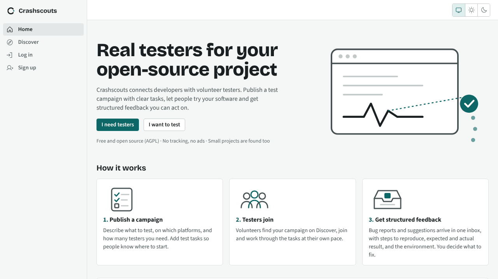

# Crashscouts

**Real testers for your open-source project.** Crashscouts connects software developers with
volunteer testers. Developers publish a test campaign with clear tasks; testers find it, try the
software and send structured feedback the team can act on.

Live at **[crashscouts.org](https://crashscouts.org)**; registration opens with the beta start.

<picture>
  <source media="(prefers-color-scheme: dark)" srcset="docs/images/home-dark.png">
  
</picture>

## What it does

- **Projects and test campaigns:** describe what to test, on which platforms, how many testers
  you need, and add test tasks.
- **Testers join** directly, by invitation or after an application, and report progress per task.
- **Structured feedback:** bug reports and suggestions with steps to reproduce, expected and
  actual result and environment, in one inbox per campaign, with a status for each item.
- **Discover:** public projects and campaigns, sorted by recent activity, never by popularity, so
  small projects are found too.
- **Moderation:** reports, warnings, blocks and account suspensions with appeals.
- **Privacy first:** no tracking, no ads, no cookie banner; statistics are counted on the server,
  never per person. Sign-in with email, passkeys, two-factor authentication or GitHub.

## Status

Live since November 2026, registration still closed. Phases 0 to 7 of the
[MVP plan](docs/MVP-PLAN.md) are done; phase 8 (release, closed beta) is in progress. The actual state is tracked in
[`docs/STATUS.md`](docs/STATUS.md).

## Stack

Python 3.14 · Django 6.1 · Django REST Framework · django-allauth · PostgreSQL 18 · React 19 ·
React Router 8 (server-side rendering) · Vite 8 · TypeScript 6 · Caddy · Docker Compose

## Run it yourself

- **Development:** GitHub Codespaces sets everything up; elsewhere see
  [`CONTRIBUTING.md`](CONTRIBUTING.md#development-environment).
- **Production:** one server with Docker Compose, Caddy and automatic TLS. The runbook
  [`docs/OPERATIONS.md`](docs/OPERATIONS.md) covers set-up, backups, email, monitoring and
  updates; the settings template is [`.env.prod.example`](.env.prod.example).

## Contributing

Contributions are welcome. Please read [`CONTRIBUTING.md`](CONTRIBUTING.md): open an issue
first, sign off every commit (Developer Certificate of Origin), and follow the
[code of conduct](CODE_OF_CONDUCT.md). Report security problems privately, as described in
[`SECURITY.md`](SECURITY.md).

## Documentation

| Document | Content |
|---|---|
| [`docs/PRD.md`](docs/PRD.md) | Product requirements (core MVP) |
| [`docs/ARCHITECTURE.md`](docs/ARCHITECTURE.md) | Architecture, data model, API, permissions |
| [`docs/SECURITY.md`](docs/SECURITY.md) | Security concept |
| [`docs/adr/`](docs/adr/) | Architecture decision records |
| [`docs/DESIGN-SYSTEM.md`](docs/DESIGN-SYSTEM.md) | Design system |
| [`docs/OPERATIONS.md`](docs/OPERATIONS.md) | Running the production server |
| [`docs/ROADMAP.md`](docs/ROADMAP.md) | Plans beyond the MVP |

## Repository layout

| Path | Content |
|---|---|
| [`backend/`](backend/) | Django API ([README](backend/README.md)) |
| [`frontend/`](frontend/) | React Router SSR app ([README](frontend/README.md)) |
| [`e2e/`](e2e/) | Playwright end-to-end tests ([README](e2e/README.md)) |
| [`deploy/`](deploy/) | Caddy, systemd units and server settings |
| [`scripts/`](scripts/) | Deploy, backup, monitoring and setup scripts |
| [`docs/`](docs/) | Product, architecture and operations documentation |

## License

[GNU Affero General Public License v3.0](LICENSE). Anyone who runs a modified version as a network
service must make its source code available to its users.
