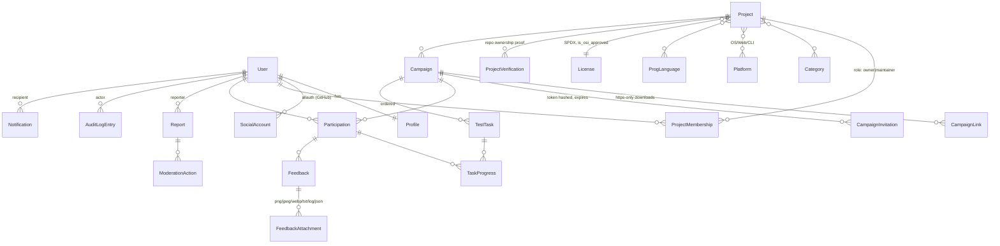

# Architektur

> Stand: 2026-11-12 · Status: **geplant, noch nicht implementiert**.
> Dieses Dokument beschreibt das Zielbild. Was davon wirklich umgesetzt ist, steht in [`STATUS.md`](STATUS.md).
> Die Begründungen stehen in den ADRs unter [`adr/`](adr/).

## 1. Überblick: modularer Monolith

```
Browser ──HTTPS──► Reverse Proxy (Prod: z. B. Caddy, TLS)
                    ├── /api/*, /_allauth/*  ──► Django (gunicorn) ──► PostgreSQL 18
                    ├── /media-protected/*  (nur via Django-Autorisierung, X-Accel)
                    ├── /admin/*  ──► 404 (öffentlich NICHT geroutet)
                    └── alles andere ──► React-Router-SSR-Server (Node 24)
                                           └─ ruft die Django-API serverseitig auf (Cookie wird weitergereicht)
Admin-Zugang (getrennt): SSH-Tunnel ──► Django-Admin auf 127.0.0.1, Login nur mit 2FA
Task-Worker (django-tasks-db, gleicher Code wie Django) ──► PostgreSQL
```

- **Ein Origin für alles:** First-party-Session-Cookies (`HttpOnly`, `Secure`, `SameSite=Lax`), CSRF-Schutz über Django, kein CORS nötig.
- **Django ist die einzige Quelle für Daten und Berechtigungen.** Der SSR-Server enthält keine Geschäftslogik und keine Geheimnisse ausser seiner internen API-URL.
- **Kein Redis und kein Celery im MVP** ([ADR 0003](adr/0003-hintergrundjobs-ohne-redis.md)).
- **Dateien:** In der Entwicklung liegen sie in einem lokalen Volume; in der Produktion in S3-kompatiblem Speicher bei einem Anbieter in der Schweiz oder EU (Entscheidung vor der Beta). Anhänge sind nie direkt öffentlich erreichbar.

## 2. Technologie (Zielversionen, Stand 2026-11-12)

| Bereich | Wahl |
|---|---|
| Backend | Python 3.14, Django 6.1 (später 6.2 LTS), Django REST Framework 3.18, drf-spectacular |
| Auth | django-allauth (headless, MFA, socialaccount/GitHub) |
| Datenbank | PostgreSQL 18 |
| Hintergrundjobs | Django Tasks und `django-tasks-db` |
| Frontend | React 19, React Router 8 (Framework-Modus, SSR), Vite 8, TypeScript 6.0 |
| Tests | pytest und pytest-django, Vitest und Testing Library, Playwright |
| Lint | Ruff, ESLint und typescript-eslint |
| Paketverwaltung | uv (`uv.lock`) und pnpm (`pnpm-lock.yaml`) |
| Container | Docker und Docker Compose |

Die Versionen werden bei jedem AP erneut geprüft und per Lockfile fixiert.

## 3. Backend-Module (`backend/apps/`)

| App | Verantwortung |
|---|---|
| `core` | Basismodelle (UUID, Zeitstempel), Berechtigungs-Helfer, zentrale Plattform-Konfiguration (Name) |
| `accounts` | Custom-User, allauth, Altersbestätigung, Löschen und Export |
| `profiles` | Profil, Interessen, Betriebssysteme, Skills, Privatsphäre |
| `catalog` | Taxonomien: Kategorien, Plattformen, Sprachen, Softwaretyp, SPDX-Lizenzen |
| `projects` | Projekte, Mitgliedschaften (Owner/Maintainer), Verifizierung, Screenshots |
| `campaigns` | Kampagnen, Links, Einladungen, Teilnahmen, Statusmaschine |
| `testing` | Testaufgaben, Fortschritt |
| `feedback` | Feedback, Anhänge, Status, Freigabe |
| `moderation` | Meldungen, Prüfqueue, Aktionen, Sperren |
| `notifications` | In-App- und E-Mail-Benachrichtigungen (über Tasks) |
| `audit` | Append-only Audit-Log |
| `discover` | Suche und Filter (PostgreSQL-Volltext) |

**Konvention:** Logik liegt in `services.py` (schreibend) und `selectors.py` (lesend). Views bleiben dünn. Berechtigungen prüft eine zentrale, serverseitige Policy-Schicht.

## 4. Frontend (`frontend/`)

- React Router Framework-Modus mit `ssr: true`.
- **Öffentlich:** Startseite, Discover, Projektseiten, öffentliche Kampagnenseiten, Profile (je nach Privatsphäre).
- **Nur nach Login:** Diese Seiten werden ebenfalls per SSR ausgeliefert, sind aber `noindex`.
- **Struktur:** `app/routes/`, `app/features/<modul>/`, `app/lib/api/` (aus OpenAPI generiert), `app/i18n/`, `app/config/brand.ts`.
- **Styling und Komponentenbibliothek sind offen** (offene Frage E).

## 5. Datenmodell (Entwurf)



- Nach aussen werden nur **UUIDs** verwendet (keine fortlaufenden IDs).
- Alle Modelle haben `created_at` und `updated_at`.
- Soft-Delete nur, wo es nötig ist (Moderation, Anonymisierung).
- Das endgültige Schema wird in `DATABASE.md` dokumentiert, sobald die Modelle existieren.

## 6. API-Konzept

- REST unter `/api/v1/`; das OpenAPI-Schema (drf-spectacular) wird in CI geprüft.
- Auth läuft über allauth headless unter `/_allauth/browser/v1/…`.
- Cursor-Pagination und ein einheitliches Fehlerformat.
- Throttling pro Nutzer und IP.
- **Private Ressourcen liefern 404 statt 403.**
- Die Endpunkte werden in `API.md` dokumentiert, sobald sie existieren.

## 7. Berechtigungsmodell

| Rolle | Darf (Auszug) |
|---|---|
| Anonym | öffentliche Projekte, öffentliche Kampagnen und veröffentlichtes Feedback lesen |
| Nutzer | Profil, Projekte anlegen, an öffentlichen Kampagnen teilnehmen, melden |
| Teilnehmer | Kampagneninhalte und Aufgaben sehen; **eigenes** Feedback anlegen und sehen |
| Maintainer | Projekt und Kampagnen bearbeiten, Teilnahmen freigeben, Feedback verwalten und einzeln veröffentlichen |
| Owner | zusätzlich Maintainer verwalten, Projekt löschen oder übertragen |
| Moderator | Meldungen bearbeiten; Zugriff auf private Inhalte nur zum gemeldeten Objekt, zeitlich begrenzt und protokolliert |
| Admin | Systemverwaltung. Django-Admin nur über einen getrennten Zugang; alltägliche Moderation über die Moderationsseiten der App |

Jede Kombination aus Rolle und Objekt wird als parametrisierter Test abgedeckt (Berechtigungsmatrix).

## 8. Entwicklungsumgebung

- **GitHub ist die einzige Quelle.** Codespaces und Claude-Cloud-Sitzungen sind austauschbare Arbeitsplätze; nicht gepushte Arbeit gilt als nicht gesichert.
- **Codespaces:** `.devcontainer/` mit Compose (workspace und `postgres:18`), Node 24, gh und dem Claude-Code-Feature `ghcr.io/anthropics/devcontainer-features/claude-code:1.0`. Container-Nutzer ist nicht root; ein Volume für `~/.claude`; weitergeleitet werden nur 5173 und 8000, privat. PostgreSQL ist nur im internen Netz erreichbar. Wird in AP 0.5 erstellt.
- **Claude-Cloud-Sitzung:** In AP 0.1 wurde verifiziert, dass `dockerd` startet und `postgres:18` (18.6) läuft. Das Setup-Skript der Umgebung folgt in AP 0.5, mit separater Freigabe.
- **Git-Ablauf (entschieden):** Commits gehen direkt auf `main`. Weil GitHub Free bei privaten Repos keinen Branch-Schutz und keine Push Protection bietet, sind gitleaks-pre-commit und CI die Schutzschicht.

## 9. Deployment (Ziel, vor der Beta)

- Docker Compose auf einem Server in der Schweiz oder EU: Proxy, Django, SSR, Worker, PostgreSQL.
- Datenbank ohne öffentlichen Port.
- Verschlüsselte, ausgelagerte Backups mit getesteter Wiederherstellung.
- Der Anbieter ist noch offen.
