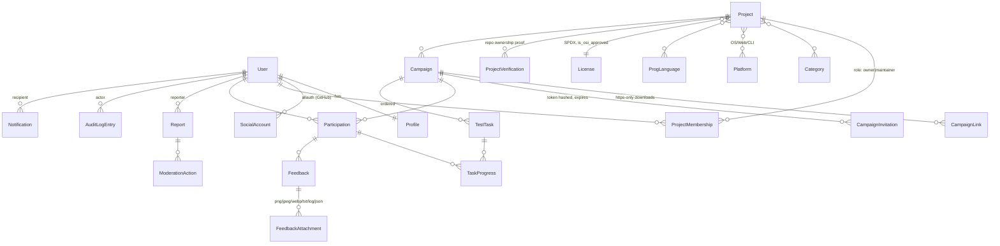

# Architecture

> As of: 2026-11-12 · Status: **partly implemented** (backend skeleton, SSR auth spike).
> This document describes the target picture. What is actually implemented is tracked in
> [`STATUS.md`](STATUS.md). Rationale lives in the ADRs under [`adr/`](adr/).

## 1. Overview: modular monolith

```
Browser ──HTTPS──► Reverse proxy (prod: e.g. Caddy, TLS)
                    ├── /api/*, /_allauth/*  ──► Django (gunicorn) ──► PostgreSQL 18
                    ├── /media-protected/*  (only via Django authorization, X-Accel)
                    ├── /admin/*  ──► 404 (NOT routed publicly)
                    └── everything else ──► React Router SSR server (Node 24)
                                           └─ calls the Django API server-side (cookie forwarded)
Admin access (separate): SSH tunnel ──► Django admin on 127.0.0.1, login only with 2FA
Task worker (django-tasks-db, same code as Django) ──► PostgreSQL
```

- **One origin for everything:** first-party session cookies (`HttpOnly`, `Secure`,
  `SameSite=Lax`), CSRF protection by Django, no CORS needed.
- **Django is the single source of data and authorization.** The SSR server contains no business
  logic and no secrets except its internal API URL.
- **No Redis and no Celery in the MVP** ([ADR 0003](adr/0003-background-jobs-without-redis.md)).
- **Files:** a local volume in development; S3-compatible storage with a Swiss or EU provider in
  production (decided before the beta). Attachments are never directly reachable.

## 2. Technology (as of 2026-11-12)

| Area | Choice |
|---|---|
| Backend | Python 3.14, Django 6.1 (later 6.2 LTS), Django REST Framework 3.18, drf-spectacular |
| Auth | django-allauth 65.22 (headless, browser client; MFA and GitHub in phase 1) |
| Database | PostgreSQL 18 |
| Background jobs | Django tasks and `django-tasks-db` (planned) |
| Frontend | React 19, React Router 8 (framework mode, SSR), Vite 8, TypeScript 6.0, react-i18next |
| Tests | pytest and pytest-django, Vitest, Playwright |
| Lint | Ruff, ESLint and typescript-eslint |
| Package management | uv (`backend/uv.lock`) and pnpm (`frontend/pnpm-lock.yaml`, `e2e/pnpm-lock.yaml`) |
| Containers | Docker and Docker Compose |

Versions are re-checked in every WP and pinned via lockfiles.

## 3. Backend modules (`backend/apps/`)

| App | Responsibility | State |
|---|---|---|
| `core` | Base models (UUIDv4, timestamps), health endpoint, permission helpers | implemented (basics) |
| `accounts` | Custom user, allauth, age confirmation, deletion and export | user model and allauth login |
| `ssr_probe` | **Test only**: probe objects for the SSR spike; never installed in production | implemented |
| `profiles` | Profile, interests, operating systems, skills, privacy | planned |
| `catalog` | Taxonomies: categories, platforms, languages, software type, SPDX licenses | planned |
| `projects` | Projects, memberships (owner/maintainer), verification, screenshots | planned |
| `campaigns` | Campaigns, links, invitations, participations, status machine | planned |
| `testing` | Test tasks, progress | planned |
| `feedback` | Feedback, attachments, status, publishing | planned |
| `moderation` | Reports, review queue, actions, blocks | planned |
| `notifications` | In-app and email notifications (via tasks) | planned |
| `audit` | Append-only audit log | planned |
| `discover` | Search and filters (PostgreSQL full text) | planned |

**Convention:** logic lives in `services.py` (writes) and `selectors.py` (reads). Views stay thin.
Authorization is checked by a central, server-side policy layer.

## 4. Frontend (`frontend/`)

- React Router framework mode with `ssr: true` ([ADR 0002](adr/0002-ssr-with-react-router.md)).
- **Public:** home page, Discover, project pages, public campaign pages, profiles (depending on
  privacy).
- **Signed-in only:** also served via SSR, but `noindex` and never cacheable.
- **Structure:**
  - `app/routes/` – route modules (loader, action, headers, meta, component).
  - `app/lib/backend.server.ts` – server-only access to Django (forwards `Cookie`, `Origin`,
    `Referer` and the CSRF token; returns `Set-Cookie`).
  - `app/lib/http.ts` – pure helpers: cache headers, cookie parsing, open-redirect protection,
    UUID validation.
  - `app/entry.server.tsx` – nonce-based CSP (production build), security headers, safe cache
    defaults.
  - `app/i18n/` – react-i18next with one instance per request and type-safe keys.
  - `app/config/brand.ts` – central brand name.
- **Styling and component library are open** (open question E). The current UI is deliberately
  unstyled.

## 5. Data model (draft)



- **Primary keys: random UUID v4** (decided 2026-11-12; implemented in
  `apps.core.models.BaseModel` and `apps.accounts.models.User`). They reveal neither record counts
  nor creation time. There are no sequential IDs.
- All models have `created_at` and `updated_at`.
- Soft delete only where needed (moderation, anonymization).
- The final schema will be documented in `DATABASE.md` once the models exist.

## 6. API concept

- REST under `/api/v1/`; the OpenAPI schema (drf-spectacular) is validated.
- Auth via allauth headless under `/_allauth/browser/v1/…` (implemented: `config`,
  `auth/login`, `auth/session` GET/DELETE).
- Cursor pagination and a uniform error format.
- Throttling per user and IP.
- **Private resources return 404 instead of 403.**
- Endpoints will be documented in `API.md` once real endpoints exist.

## 7. Permission model

| Role | May (excerpt) |
|---|---|
| Anonymous | read public projects, public campaigns and published feedback |
| User | profile, create projects, join public campaigns, report |
| Participant | see campaign content and tasks; create and see **own** feedback |
| Maintainer | edit project and campaigns, approve participations, manage and individually publish feedback |
| Owner | additionally manage maintainers, delete or transfer the project |
| Moderator | handle reports; access to private content only for the reported object, time-limited and logged |
| Admin | system administration. Django admin only via a separate access path; day-to-day moderation via the app's moderation pages |

Every combination of role and object is covered by a parametrized test (permission matrix).

## 8. SSR request flow (validated in WP 0.4)

1. The browser sends a request with its cookies to the SSR server.
2. Loaders/actions call Django via `backendFetch`, forwarding `Cookie` (and for writes `Origin`,
   `Referer` and the CSRF token from the form).
3. Django authenticates, authorizes and answers; private objects yield 404.
4. The SSR server returns any `Set-Cookie` from Django unchanged and sets cache headers:
   `private, no-store` + `Vary: Cookie` whenever a session may be involved; `public, max-age=60`
   only for anonymous public pages, which never set cookies.
5. React Router additionally rejects actions from a foreign `Origin` (400).

Forms work without JavaScript (progressive enhancement); with JavaScript they are submitted via
React Router's data requests.

## 9. Development environment

- **GitHub is the single source of truth.** Codespaces and Claude cloud sessions are
  interchangeable workplaces; unpushed work counts as not saved.
- **Codespaces:** `.devcontainer/` with Compose (workspace and `postgres:18`), Node 24, gh and the
  Claude Code feature `ghcr.io/anthropics/devcontainer-features/claude-code:1.0`. The container
  user is not root; a volume for `~/.claude`; only ports 5173 and 8000 are forwarded, privately.
  PostgreSQL is reachable on the internal network only. Created in WP 0.5.
- **Claude cloud session:** WP 0.1 verified that `dockerd` starts and `postgres:18` (18.6) runs.
  Background processes are stopped after their time limit, so `dockerd` may need restarting. The
  environment's setup script follows in WP 0.5 (separate approval).
- **Git workflow (decided):** commits go directly to `main`, authored by the project owner, with
  English commit messages. Because GitHub Free offers no branch protection and no push protection
  for private repositories, gitleaks and CI are the protective layer.
- **Local ports:** Django 8000, Vite dev server 5173 (proxies `/api` and `/_allauth` to Django),
  production SSR build 3000 (E2E tests). All bound to `127.0.0.1`.

## 10. Deployment (target, before the beta)

- Docker Compose on a server in Switzerland or the EU: proxy, Django, SSR, worker, PostgreSQL.
- Database without a public port.
- Encrypted, off-site backups with a tested restore.
- The provider is still open.
