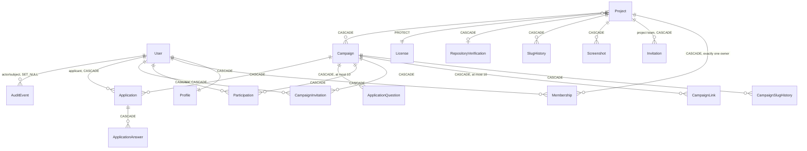

# Data model

> State after phase 3A (2026-11-13). Generated from the models in `backend/apps/*/models.py`;
> update this file in the same commit as any model change.

All own tables use a random UUIDv4 primary key and `created_at`/`updated_at`
(`apps.core.models.BaseModel`); catalog entries use UUIDs without timestamps.

## Overview

## Tables by app

| App | Model | Purpose | Personal data and deletion |
|---|---|---|---|
| accounts | `User` | account (email login, username, age confirmation, deletion schedule, `platform_role` – ADR 0018) | deleted after the 14-day grace period (ADR 0013) |
| profiles | `Profile` | bio, link, interests, platforms, skills, avatar; `show_*` visibility per field | deleted with the account (CASCADE) |
| audit | `AuditEvent` | append-only security log | `actor`/`subject` set to NULL when an account is deleted; no IPs, no tokens |
| catalog | `Category`, `Platform`, `Skill`, `ProgrammingLanguage`, `License` | fixed lists (SPDX licences) | none |
| projects | `Project` | project with short name, visibility, licence, repository link, logo, `blocked_at` (ADR 0020) | – |
| projects | `Membership` | owner/maintainer | deleted with the account; projects are handed over first |
| projects | `Invitation` | team invitations | invitee: CASCADE; `invited_by`: SET_NULL |
| projects | `Screenshot`, `SlugHistory` | images, former short names | – |
| projects | `RepositoryVerification` | proof of repository ownership (ADR 0015) | `verified_by`: SET_NULL |
| campaigns | `Campaign` | test campaign; stored state plus `published_at`, `completed_at`, `cancelled_at` | `published_by`: SET_NULL (metrics, docs/METRICS.md) |
| campaigns | `CampaignSlugHistory` | former short names | – |
| campaigns | `CampaignLink` | download links (ADR 0017); `suspended_at`/`suspended_reason` after malware reports (ADR 0019) | – |
| campaigns | `CampaignInvitation` | invitations to private campaigns | invitee: CASCADE; `invited_by`: SET_NULL |
| campaigns | `Participation` | taking part (`active`/`left`/`removed`; one per person and campaign) | CASCADE with the account (frees the place) |
| campaigns | `ApplicationQuestion` | per-campaign questions | – |
| campaigns | `Application` | application (`pending`/`approved`/`rejected`/`withdrawn`) | applicant: CASCADE; `decided_by`: SET_NULL |
| moderation | `Block` | moderators' block with message, lifting and one appeal (ADR 0020) | `created_by`/`lifted_by`/`appealed_by`: SET_NULL; target: CASCADE |
| moderation | `ModerationNote` | warning to a project's team, moderators only | `created_by`: SET_NULL |
| moderation | `Report` | report of a project, campaign or link (ADR 0019); `target_label` copy | reporter: SET_NULL; targets: SET_NULL |
| campaigns | `ApplicationAnswer` | answers (question text kept) | deleted on rejection, withdrawal, leaving, removal, 30 days after the campaign ends, and with the account |

## Retention jobs (daily)

- `manage.py purge_deleted_accounts` – final account deletion after 14 days.
- `manage.py purge_application_answers` – application answers 30 days after a campaign ended.

## During the deletion grace period

Accounts scheduled for deletion are deactivated and invisible: they are not listed in project
teams, campaign participant lists or open applications, and cannot be invited. Their campaign
participations keep their places until the final deletion (owner's decision, 2026-11-13).

## Data export

`/api/v1/me/export/` (`apps/accounts/lifecycle.py::export_data`) contains everything above that
belongs to the person: account, profile, projects and team invitations, connected accounts, 2FA
method types, security log, campaign participations, campaign invitations, applications with
their own answers, the campaigns they published, and their reports (with their own text).
